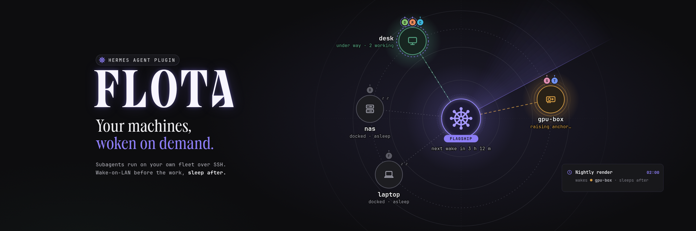
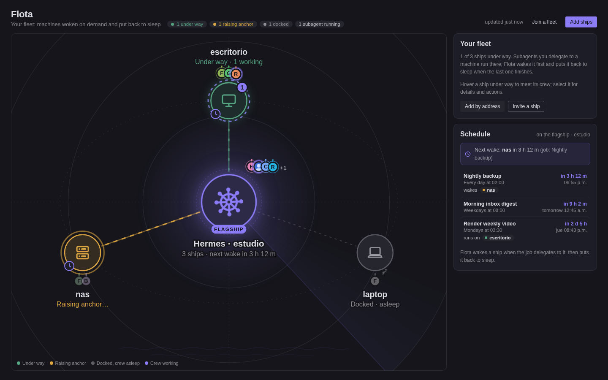
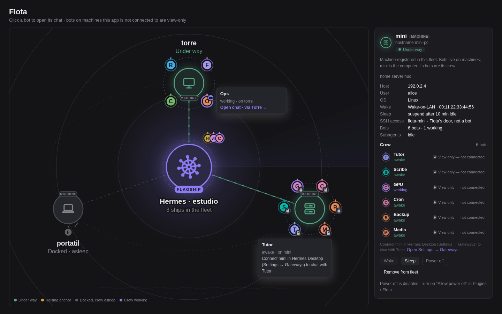
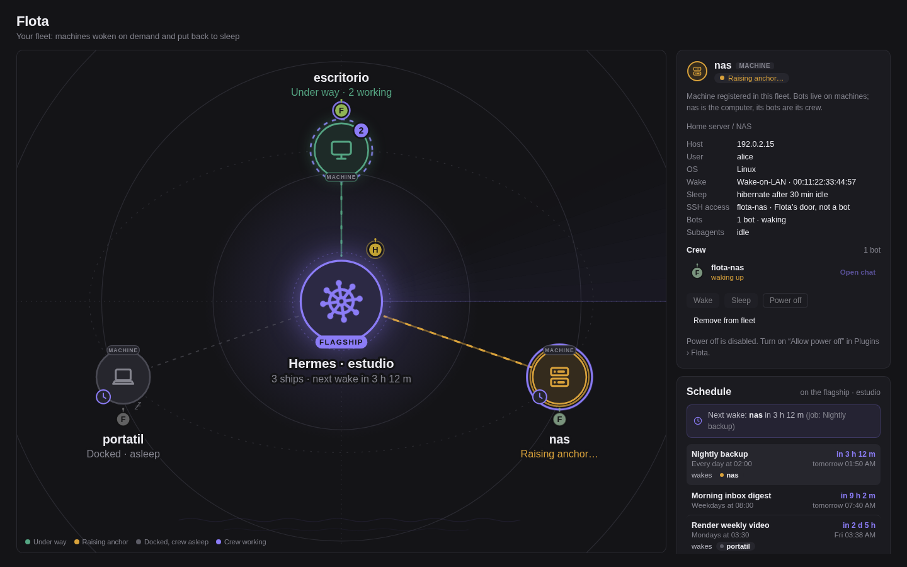
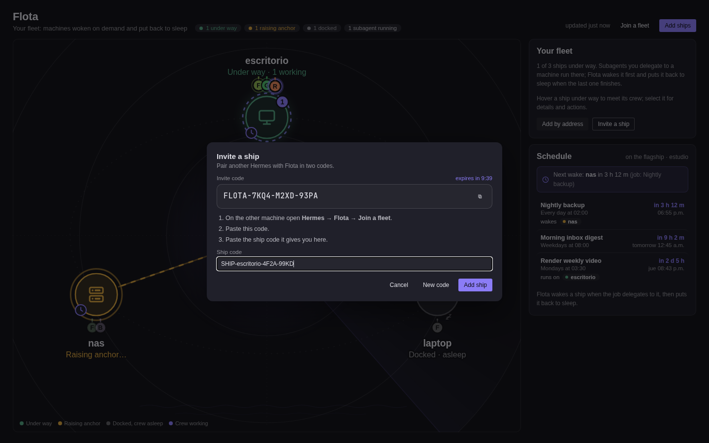
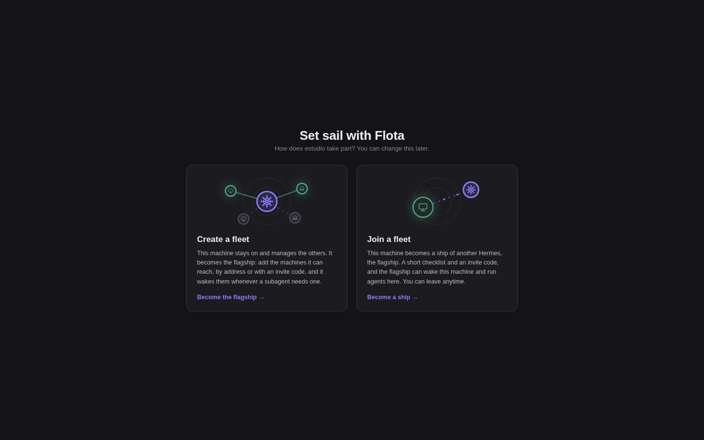
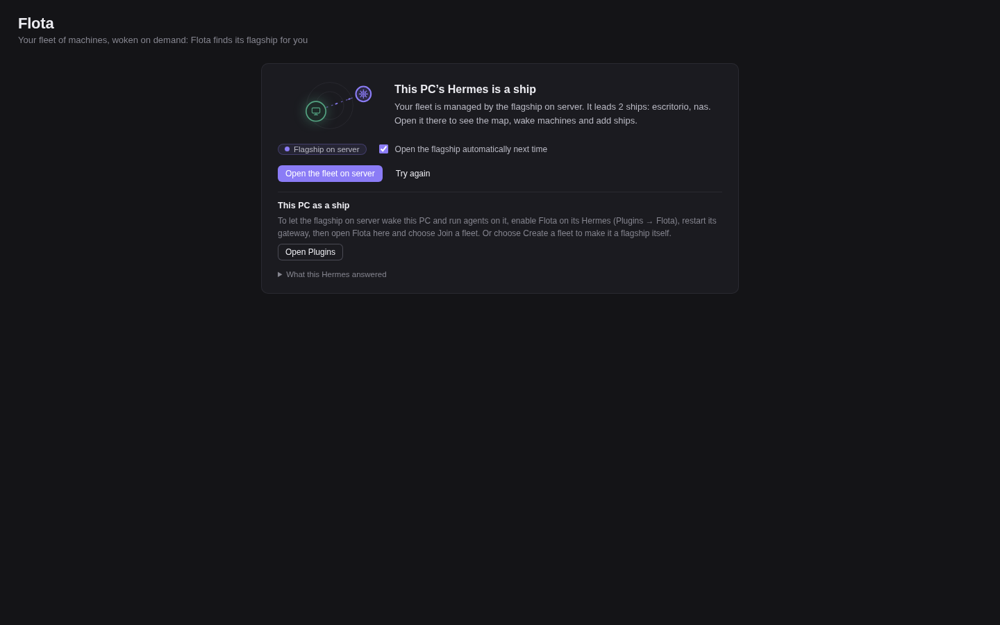

# Flota



**Run Hermes subagents on your own machines. Flota wakes the right one, runs the subagent there over SSH, and puts the machine back to sleep when the work is done.**

Your desktop can take the heavy builds, local models and long jobs without staying on all day. Hermes stays on a small always-on host (the *flagship*); your other computers (the *ships*) sleep until a task needs them.

**Measured on real hardware** (2026-11-10, a Linux home server driving a Linux desktop over Tailscale, Wake-on-LAN on the LAN): waking the suspended desktop took **19-42 s** until SSH answered; a scheduled job woke it (about **27 s**), ran there, and Flota suspended it **2 minutes** after the job (`sleep_after: 2m`); Flota refused to sleep the desktop while a subagent was running on it.

▶ **Demo video (88 s):** [watch on X](https://x.com/Alberto47045726/status/2120526319301910729)

## Why it has to be a plugin

A skill or an MCP tool can send a magic packet. It can't do the three things Flota exists for:

1. **Choose where a subagent runs.** Flota is a `delegation.backend`. Hermes asks it to route each `delegate_task` task, and Flota answers with a Hermes profile whose terminal is SSH on the chosen machine.
2. **Wake the machine before the subagent exists.** The wake happens inside `route_task`, before Hermes builds the child, so a subagent never starts on a machine that is off.
3. **Sleep the machine after its last child.** The `subagent_start` / `subagent_stop` lifecycle hooks tell Flota when a machine has nothing left to do. Flota then starts an idle timer and suspends it, never while it is busy.

## Quick start

You need Hermes 0.22.5 or later on a Linux host, the `ssh` client, and a machine you can already `ssh alice@desk` into with a key. Keep the machine on for step 2.

```sh
# 1. Install and enable the plugin
hermes plugins install https://github.com/Bto-03/hermes-flota --enable

# 2. Add the machine (named "desk" after its host). Flota detects its OS, LAN interface, MAC,
#    broadcast address, Wake-on-LAN state and how it can sleep, and creates the profile flota-desk
hermes flota setup alice@desk

# 3. Route subagents through Flota
hermes config set delegation.backend flota
```

If a gateway is running, restart it (`hermes gateway restart`). Then ask the agent something like "build the project on desk". `hermes flota doctor` checks every machine end to end, `/flota dry-run desk` in a chat explains what a delegation would do without sending anything, and bare `hermes flota` always prints the next step.

If the other machine runs its own Hermes with Flota, pair them with two codes instead: `hermes flota invite` here prints a `hermes flota join ...` line to paste there, which prints a `hermes flota add-ship ...` line to paste back. See [docs/pairing.md](docs/pairing.md).

## Features

- **A machine per task.** `delegate_task` gets a `machine` field listing your machines and their descriptions. A task naming no machine runs on `default` if you set one (Flota wakes it too), otherwise on the normal route. If a machine won't wake, Flota tries its `fallback` once.
- **Five wake methods:** `wol` (Wake-on-LAN from the Hermes host), `wol_via` (an always-on host on the machine's LAN sends the packet over SSH), `command` (any local command, such as a smart plug), `timer` / `wake_timer: true` (before it sleeps, the machine arms its own RTC alarm for its next cron job), `none` (you turn it on by hand; such a machine is not auto-slept unless you set `sleep`).
- **Auto-sleep that respects busy machines.** After `sleep_after` with no subagents, Flota suspends, hibernates or powers off the machine. That also covers a machine woken by hand, by the agent tool, by its wake timer, or left marked busy by a gateway that restarted. A failed auto-sleep is retried once.
- **Busy is enforced.** Nothing Flota does on its own, and nothing the model asks for, stops a machine with running subagents. Only a person can force it: `--force` on the CLI, `force` in `/flota`, or a confirmation on the Flota page.
- **Power-off only when Flota can turn the machine back on** (`wol`, `wol_via`, `command`). Every other machine can only be suspended.
- **Agent tool `flota`**: `status` and `wake`. `sleep` and `off` are off by default; with `agent_power_actions` on, each call asks for your approval first, because whoever is using that machine loses their session (no force option either way).
- **Chat command `/flota`**: `status`, `dry-run <machine>`, `wake <machine>`, `sleep <machine> [force]`, `off <machine> [force]`.
- **CLI `hermes flota`**: `setup`, `remove`, `doctor [--fix]`, `uninstall`, pairing (`invite`, `join`, `join-check`, `add-ship`, `leave`, `role`) and machine commands (`status`, `dry-run`, `wake`, `sleep`, `off`). Every command ends with a `Next:` hint. See [docs/cli.md](docs/cli.md).
- **Flota page for Hermes Desktop and the Webapp.** A naval map with Hermes as the flagship and your machines as ships, each with its crew (the Hermes bots that live there), the flagship's cron **Schedule** with the ship each job wakes, invite/join wizards, and a card that finds your flagship on another connection.
- **Web dashboard tab** (`hermes dashboard` → Flota): a live network map with wake, sleep, power off and add/remove machine.
- **Settings panel** in Plugins → Flota.
- Python standard library only. 902 tests; none touches the network, SSH or a real machine.

## Screenshots

| | |
|---|---|
|  |  |
| The fleet map with the flagship's Schedule | Each ship carries its crew; bots on connected machines open a chat |
|  |  |
| A ship's details next to the Schedule | Pairing another Hermes with two codes |
|  |  |
| First run: create a fleet or join one | Any connection finds the flagship and offers to open the fleet there |

All screenshots use made-up demo data.

## Requirements

- **Hermes host:** Hermes ≥ 0.22.5 (pluggable delegation backends), Linux, OpenSSH client. Auto-sleep timers need a long-lived process, such as the gateway.
- **Each machine:** `sshd` with your key authorised (Flota uses `BatchMode=yes` and never types a password), and a shell. It doesn't need Hermes, Python or an API key: the subagent's agent loop runs on the Hermes host, and only its terminal commands run on the machine.
- **To wake it**, one of: Wake-on-LAN enabled in the firmware and on the NIC with the Hermes host on the same LAN (`wol`); an always-on host on that LAN with `python3` (`wol_via`); a wake command (`command`); a self-armed RTC alarm (`timer`).
- **To sleep it (Linux):** `systemctl suspend` must work over SSH without a password. `setup` checks this and prints a one-time polkit rule if it doesn't.

## Limitations

- **Platforms.** Linux (Hermes host and machines) is supported and tested on real hardware. macOS and Windows ships are experimental: their power commands and wake timers are unit-tested only.
- **Timer mode (`wake: timer`) is untested on real hardware**: arming the RTC alarm / scheduled task is unit-tested only. Some firmware and Modern Standby laptops ignore wake alarms.
- **Full power-off** needs Wake-on-LAN from S5 enabled in the BIOS/UEFI; Flota can't check that (`doctor` tells you how to test it once).
- **Plain Wake-on-LAN needs the same LAN.** Across routers or Tailscale use `wol_via`, `command` or `timer`.
- **One delegation backend at a time**: `delegation.backend: flota` replaces any other.
- **Auto-sleep needs a long-lived gateway**; a one-shot `hermes chat -q` exits before the timer fires.
- **Children are matched to machines by goal text** (core's hooks carry no route); identical goals for different machines in one batch can be swapped.
- **SSH file sync is still on with Hermes 0.23.1.** Hermes' SSH terminal copies this host's `~/.hermes` files to the machine when a subagent connects and tars the machine's `~/.hermes` back when it ends, which is slow on a machine with its own Hermes install. Flota sets `terminal.ssh_sync_files: false` in each machine's profile, but core doesn't read that key yet ([issue #148726](https://github.com/NousResearch/hermes-agent/issues/148726)); `doctor` warns about it. See [docs/troubleshooting.md](docs/troubleshooting.md#subagents-on-a-flota-machine-are-slow-to-finish).
- **`hermes plugins validate` warns about private core imports**: Flota uses a few core modules that are not public plugin API (profiles, cron jobs, atomic config write), so a core release can break them. See [docs/security.md](docs/security.md#install-scan).

## Security

- Pairing exchanges **public keys only**. An invite expires after 30 minutes and adds one ship. A pasted ship code can't silently re-point an existing machine to a new address or user (`--replace` is needed).
- Flota never asks for a password and never runs an interactive `sudo`. It prints the one-time root steps it needs (a polkit rule, enabling Wake-on-LAN, wake-timer permission) for you to run. The only privileged command it runs is `sudo -n` for the wake alarm, and only where you added that exact sudoers rule.
- **The pairing key has no passphrase and no restrictions.** If you set no `ssh_key` and this host has no `id_ed25519.pub` in your SSH folder, pairing creates a new key pair, `flota_ed25519`, **without a passphrase**, so Flota can log in unattended. Each ship that joins adds that public key to its `authorized_keys` file as an ordinary login line, **without `command=` or `restrict` options**: whoever holds the private key gets a normal shell on that ship, as that user. Pair with a dedicated, unprivileged ship user if that matters to you; `hermes flota leave` on the ship takes the line back. Details: [docs/security.md](docs/security.md#the-key-a-ship-authorises).
- The model can't suspend or power off a machine unless you turn on `agent_power_actions`, and then only after you approve each request; it can never stop a busy machine. The dashboard and the Flota page can't set shell-bearing keys: `wake_command` and `sleep_command` come only from `config.yaml`; `power_prefix` and `profile` also from `setup`. Every POST to the plugin API must be JSON (a cross-site form can't trigger it).

Full threat model: [docs/security.md](docs/security.md). To report a vulnerability, see [SECURITY.md](SECURITY.md).

## Uninstall

```sh
hermes flota uninstall          # shows what it would undo; changes nothing
hermes flota uninstall --yes    # forgets the machines, deletes the flota-* profiles Flota created,
                                # and takes back the flagship login keys Flota added on this account
hermes config set delegation.backend default   # only if it was flota (uninstall prints this)
hermes plugins remove flota
```

`uninstall` refuses while a machine is busy. It deliberately leaves keys alone; details and root changes on each machine are listed in [docs/installation.md](docs/installation.md#uninstalling).

## Documentation

| | |
|---|---|
| [Installation](docs/installation.md) | Install, enable, first machine, the Flota page, uninstall |
| [Configuration](docs/configuration.md) | Every panel setting and per-machine key |
| [Pairing](docs/pairing.md) | Fleet roles, invite and ship codes, what is exchanged |
| [Power](docs/power.md) | Suspend, hibernate and power off per OS, polkit, wake timers |
| [Desktop page](docs/desktop-page.md) | Enabling it, the map, crews, connection switching, REST API |
| [CLI](docs/cli.md) | Every `hermes flota` command, flag and exit code |
| [Architecture](docs/architecture.md) | Routing flow, hooks, state files |
| [Troubleshooting](docs/troubleshooting.md) | `doctor` lines and their fixes |
| [Security](docs/security.md) | Threat model: what Flota does and doesn't do |
| [Windows ship](docs/windows.md) | Checklist for a Windows 10/11 ship (experimental) |

## Development

See [CONTRIBUTING.md](CONTRIBUTING.md). [CHANGELOG.md](CHANGELOG.md) lists the changes in each release.

## License

MIT © Francisco Bastidas. See [LICENSE](LICENSE).
