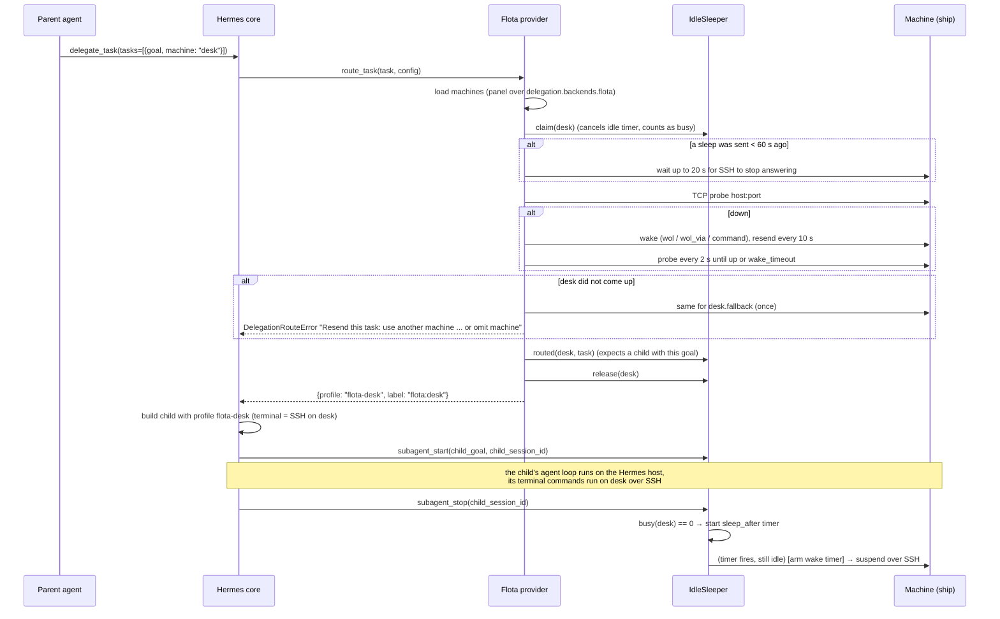

# Architecture

Flota is a standalone Hermes plugin with no Python dependencies beyond the standard library. `register(ctx)` in `__init__.py` wires up:

| Registration | Module | Purpose |
|---|---|---|
| `register_delegation_provider` | `provider.py` | The `flota` delegation backend: `task_parameters`, `description`, `route_task` |
| `register_hook("subagent_start" / "subagent_stop")` | `idle.py` | Busy counts and idle timers |
| `register_tool("flota")` | `tool.py` | Agent tool: `status`, `wake`; `sleep`, `off` only with `agent_power_actions` (offered while `agent_tool` is on) |
| `register_hook("pre_tool_call")` | `tool.py` | Sends every `flota` tool call with `sleep` / `off` to Hermes' approval prompt |
| `register_command("flota")` | `slash.py` | `/flota` in chats |
| `register_cli_command("flota")` | `cli.py` | `hermes flota ...` |

Flota never replaces or wraps a Hermes core class or method; it changes core behaviour only through config keys and the hooks above.

The dashboard tab and the Flota page are served by `dashboard/plugin_api.py` (a FastAPI router loaded by Hermes from `dashboard/manifest.json`). It reuses the same modules.

If the Hermes core has no `agent.delegation_provider`, `register` logs a warning and returns without registering anything.

## Routing a task



Notes:

- **The schema.** `task_parameters` adds a `machine` string enum, built from the loaded machines and their descriptions, to `delegate_task`'s task schema. A task without `machine` uses `default` when it's set to a loaded machine; otherwise `route_task` returns `{}` and Hermes uses its normal route.
- **One wake per machine.** A per-machine lock means two sessions asking for the same sleeping machine send one wake; the second finds the machine already up.
- **Fallback once.** If `machine` doesn't come up, its `fallback` is tried. The fallback's own fallback is never followed. The error lists the other machines, so the agent can resend the task.
- **Guidance.** `description()` tells the agent that tasks for different machines run in parallel, and that a subagent silent for longer than `cache_ttl` should be replaced rather than revived.

## Busy state

`IdleSleeper` (one per process) tracks, per machine:

- `_claims`: routes being prepared (from `claim` until `release`).
- `_expected`: tasks routed whose child hasn't started yet, as `(goal, machine, time)`. The hooks carry no route label, so a child is matched to its machine by **goal text**. An expectation older than 10 minutes counts as a child that never started.
- `_running`: `child_session_id → machine` between `subagent_start` and `subagent_stop`.

`busy(machine)` is the sum of the three. Auto-sleep, `/flota sleep|off` and the agent tool all go through the sleeper and refuse when it's non-zero. The agent tool has no force option; `/flota sleep|off <machine> force` (typed by a person) clears the machine's timer and powers it down directly.

`watch(machine)` starts an idle timer for a machine that is awake with no subagent: after `/flota wake`, the tool's `wake`, a self-armed wake timer's job, or, on the first delegation of a new process, for machines a dead process (a restarted gateway) left busy in `state.json`. The timer sleeps the machine only if it is still up and idle after a full `sleep_after`; a failed auto-sleep is checked again once, 60 s later.

Whenever the counts change, the sleeper writes them atomically to `<hermes home>/flota/state.json`:

```json
{"pid": 12345, "updated": 1794355200.0, "busy": {"desk": 1}}
```

The CLI (`hermes flota sleep|off|status`) and the dashboard run in other processes and read this file (`idle.read_busy`). They trust it only if `pid` is alive and `updated` is less than a day old; otherwise "busy unknown". One state file per profile: two processes running subagents at once (a gateway and a chat session) overwrite each other's counts.

## Owner scope

`hermes flota setup` clones each `flota-<machine>` profile from the profile that owns the fleet, so the plumbing profile's config also enables Flota. The desktop app sends plugin requests to the profile you last chatted with, which may be a plumbing profile if you opened a ship bot's chat. Without a guard, Flota would read and write a stale copy of the fleet there.

`home.py` maps every Hermes home to its **owner**. A `<root>/profiles/flota-*` home maps to the profile named in its `flota/owner` file (written at setup), else to the root Hermes home. Every other home owns itself. Config reads and writes, invites, busy state, wake-timer state, cron reads and profile clones all run inside `home.owner_scope()`. That scope sets core's context-local Hermes-home override and never touches environment variables.

## SSH file sync

Core's SSH terminal mirrors local skills, credentials and caches into `<remote $HOME>/.hermes` when it connects. On cleanup it tars that whole directory back (120 s timeout, three tries). That suits a throwaway box, but a Flota machine is one of your own computers: its `~/.hermes` may be a real Hermes install of many GB. The push writes this host's files, credentials included, into it, and the pull can time out after holding the parent for minutes.

Flota writes `terminal.ssh_sync_files: false` into the config of every machine profile it creates (`setup`, `add-ship` and the Flota page all go through `cli.run_setup`), and `hermes flota doctor --fix` writes it into profiles that already exist (`ssh_sync.py`). That key is proposed in core ([issue #148726](https://github.com/NousResearch/hermes-agent/issues/148726), PRs #148791 and #145271, env var `TERMINAL_SSH_SYNC_FILES`). **Hermes 0.23.1 does not read it yet**, so until a core release does, a Flota subagent still syncs files both ways. `doctor` shows `! SSH file sync is still on` while that is the case; it judges support from the public `hermes_cli.config.DEFAULT_CONFIG`. Flota used to wrap core's SSH terminal constructor to force the sync off; that was removed in 0.2.2, because a catalog plugin must not replace core methods.

## Modules

| Module | Responsibility |
|---|---|
| `machines.py` | Parse and validate machine entries; never raises |
| `settings.py` | Merge the panel over the old `delegation.backends.flota` block; power-off rules |
| `wake.py` | Magic packets, `wol_via`, wake commands, `ensure_ready` (probe → wake → wait) |
| `power.py` | Power commands per OS, `ssh_argv`, polkit/niri detection, OS detection |
| `waketimer.py` | Next cron job per machine, arming RTC / `pmset` / scheduled-task alarms, capability probe |
| `idle.py` | `IdleSleeper`, `state.json` |
| `detect.py` | LAN interface, MAC, broadcast, Wake-on-LAN state (remote and local), Tailscale address |
| `pairing.py` | Invite and ship codes, `authorized_keys` add/remove, join checks, host selection |
| `crew.py`, `remote_crew.py` | Bots on the flagship and on each ship (read-only SSH scan, cached) |
| `home.py` | Owner scope; hiding plumbing profiles from the Bots roster |
| `ssh_sync.py` | The `terminal.ssh_sync_files` key: write it, read it, detect core support |
| `cli.py`, `slash.py`, `tool.py` | User surfaces |
| `dashboard/plugin_api.py` | REST backend for the dashboard tab and the Flota page |

## Known limits

- Only one delegation backend can be active: `delegation.backend: flota` replaces any other.
- Auto-sleep timers live in the running process, so auto-sleep needs a long-lived gateway.
- Hermes routes the tasks of one `delegate_task` call one after another, so a slow wake delays the later tasks of that batch.
- Children are matched to machines by goal text. Identical goals sent to different machines in one batch can be swapped.
- Until core reads `terminal.ssh_sync_files` ([issue #148726](https://github.com/NousResearch/hermes-agent/issues/148726)), a subagent on a Flota machine syncs files over SSH again (see [SSH file sync](#ssh-file-sync)).
- The agent tool's schema is fixed when the plugin registers: turning `agent_power_actions` on reaches the model in new sessions.
