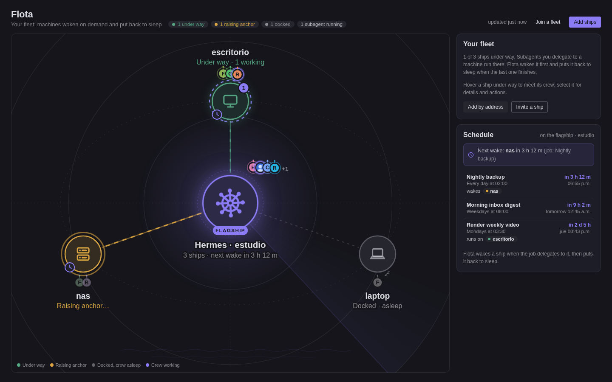
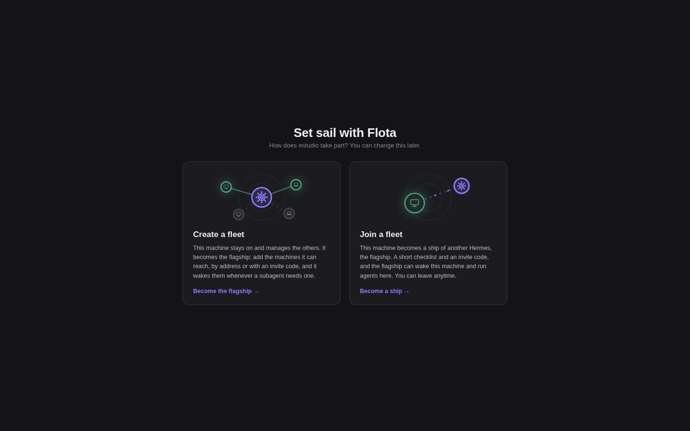
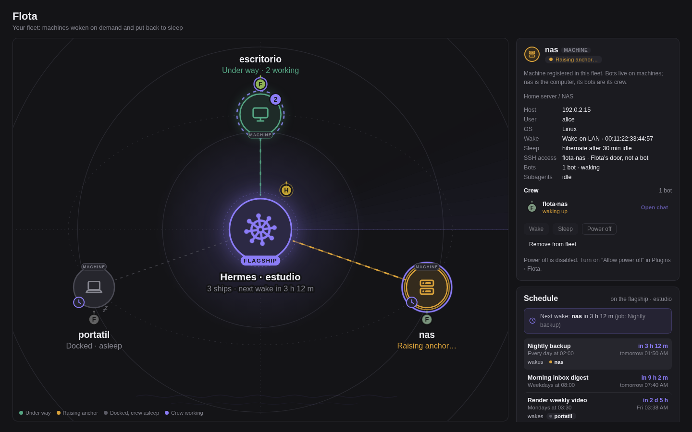
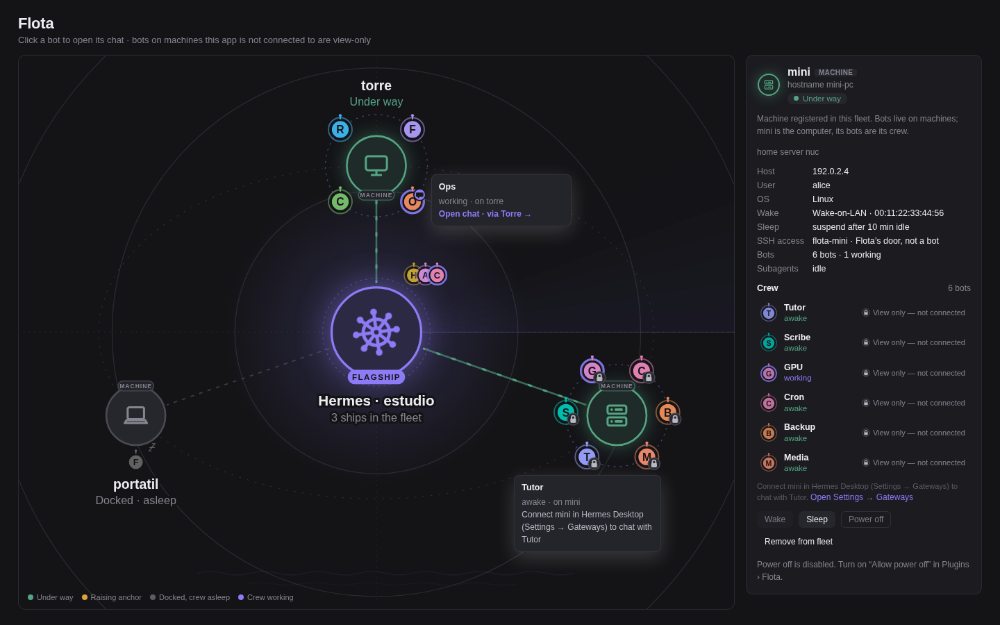
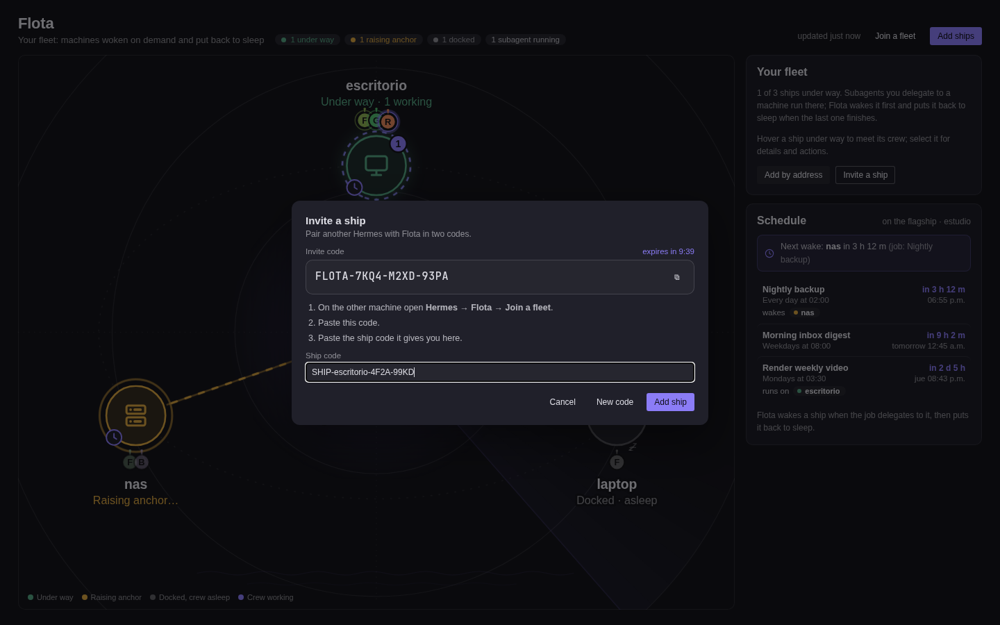
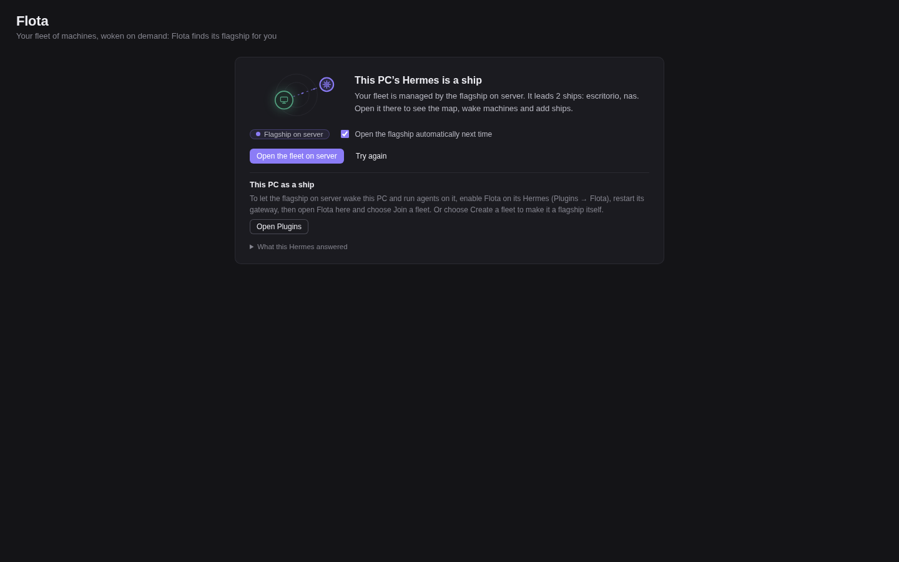
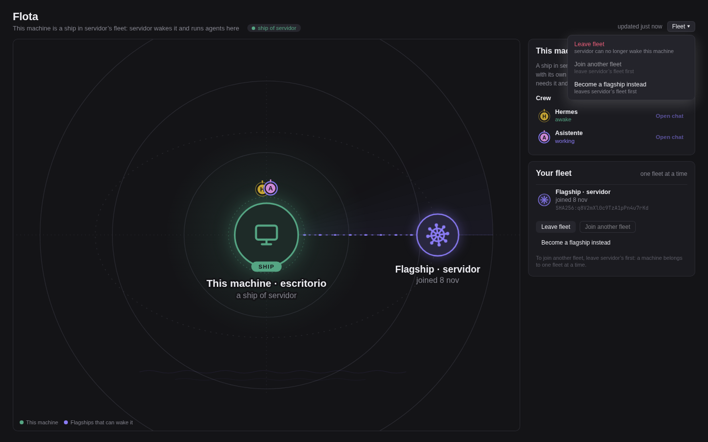

# The Flota page (Hermes Desktop and Webapp)

Flota ships two user interfaces, both served by the plugin's own backend (`dashboard/plugin_api.py`, mounted at `/api/plugins/flota`):

| UI | File | Where it appears |
|---|---|---|
| **Flota page** | `desktop/plugin.js` | Hermes Desktop and the Webapp: a sidebar entry **Flota**, the route `/flota`, a command-palette entry "Flota: open fleet map", and a status-bar chip (`Flota 2/3 up`) |
| **Dashboard tab** | `dashboard/dist/index.js` | The classic web dashboard (`hermes dashboard`): a **Flota** tab after Plugins |

## Enabling it

- **Desktop / Webapp:** open **Plugins → Flota** and turn the plugin on, then restart the gateway of the Hermes it should talk to. The page talks to the backend of the connection and profile the app is using (see [Connections](#connections-and-profiles)).
- **Dashboard tab:** appears as soon as the plugin is enabled. Add `?flota_demo=1` to the dashboard URL for five made-up machines; demo mode touches nothing real.

## First run: choose a role

With no machines and no fleet, the page asks what this Hermes is:

- **Create a fleet** makes it a flagship (`role: flagship`). You add ships by invite or by address.
- **Join a fleet** opens the join wizard on this machine. You paste the flagship's invite, the page runs the reachability checks and shows how this machine could be woken (Wake-on-LAN, relayed Wake-on-LAN, wake timer, by hand). It then shows the ship code to paste back on the flagship.

Pairing works the same way as on the CLI; see [pairing.md](pairing.md).

## The map

- The **flagship** (this Hermes) is in the centre and each **ship** sits around it: in colour when under way (SSH answers), grey when docked (asleep), amber while raising anchor (waking). The page polls `/status` every 5 s.
- Each ship carries its **crew**: the Hermes bots that live on it. Flota discovers them over SSH with one read-only call that reads `profile.yaml`, avatars and gateway state, and never `config.yaml` or credentials. The result is cached and refreshed in the background. Crew members sleep while the ship is docked and are awake or working while it's under way and subagents run there.
- Click a bot to **open its chat** if this app has a connection that reaches that machine. Otherwise the bot shows a padlock (view-only) and the reason.
- Click a ship for its details and **Wake**, **Sleep**, **Power off** and **Remove from fleet**. Power off is offered only for machines Flota can wake again (see [power.md](power.md#power-off-only-where-flota-can-wake-the-machine)). Sleeping or powering off a busy machine asks for confirmation first.
- **Remove from fleet** deletes the machine from the panel and keeps its `flota-<name>` profile (`hermes profile delete` removes it).
- **Schedule**: the flagship's cron jobs, soonest first, with a plain-English schedule ("Every day at 02:00") and the ship each job will wake. A job wakes a ship when it names it, the same rule the wake timers use ([power.md](power.md#wake-timers)).

## Adding ships

- **Invite**: shows a fresh invite code with a countdown (30 minutes) and a box for the ship code that comes back, with an optional ship name (otherwise the ship's hostname). If the code matches a machine already in the fleet but logs in somewhere new, nothing is changed and the page explains why; if you really moved that machine, press **This machine really moved - replace it**.

  

- **Add by address**: name, SSH user, host, optional key, and optional wake and sleep settings. This runs the same `setup` as the CLI and shows each step. Leave the MAC empty: Flota connects over SSH and detects it for Wake-on-LAN. The form can't set shell-bearing keys (`wake_command`, `sleep_command`, `power_prefix`) or the profile; edit those in `config.yaml`.

## Connections and profiles

Hermes Desktop sends plugin requests to the **profile you last chatted with**, on the **connection** you're using. Flota keeps its state in the profile that owns the fleet, and handles the two common mix-ups:

- **A `flota-<machine>` profile.** If you opened a ship bot's chat, the request lands in a plumbing profile. Flota maps that profile to its owner (`<profile>/flota/owner`), so the page still shows the real fleet.
- **A connection without Flota.** If the current connection or profile doesn't run Flota, the page doesn't just show an error. It asks the app's other connections whether they run Flota, and offers to open the fleet there ("Open the fleet on ..."). If several connections run Flota, it lists them and you choose one.
- **Opening the flagship automatically is opt-in.** Tick "Open the flagship automatically next time" ("Open the one I choose automatically next time" with several) and the page switches there by itself; it then says so in a notice and shows **Opens automatically · turn off** in the Flota header to stop it.

On a ship, the page shows the fleet it belongs to and lets you **leave** it.

## Backend endpoints

All relative to `/api/plugins/flota`:

| Method | Path | What |
|---|---|---|
| GET | `/status` | Machines, up/down, busy counts (`busy_known`), crews, role, fleet |
| GET | `/schedule` | Cron jobs and the machines each one names |
| POST | `/wake/{name}` | Start a wake (202); the status shows `waking` |
| POST | `/sleep/{name}`, `/off/{name}` | Sleep / power off; 409 for a busy machine unless the body is `{"force": true}` (or `?force=1`) |
| POST | `/machines` | Add or update a machine (runs setup) |
| DELETE | `/machines/{name}` | Remove a machine from the panel (profile kept) |
| POST | `/role` | Set the role; 409 with `needs` when ships or a fleet are in the way |
| POST | `/invite` | Mint an invite |
| GET | `/invite` | Read-only: the last unexpired invite minted by this backend, or `{"code": null}` |
| POST | `/join` | Join with an invite (ship side). Needs `confirm`: the invite's flagship name or key fingerprint; otherwise 409 `{needs: "confirm", flagship, pubkey_fingerprint}` and nothing is trusted |
| GET | `/join/check` | Reachability checks and wake options (ship side) |
| GET | `/fleets`, DELETE `/fleets/{flagship}` | The fleet this machine belongs to; leave it |
| POST | `/ships` | Add a ship from its ship code (flagship side). Optional `name`, and `replace: true` to re-point a machine that really moved |

Every POST must be sent as `Content-Type: application/json`; anything else gets 415 (see [security.md](security.md#csrf-and-the-rest-api)). Crew rows from ships are sanitised before they are returned.
